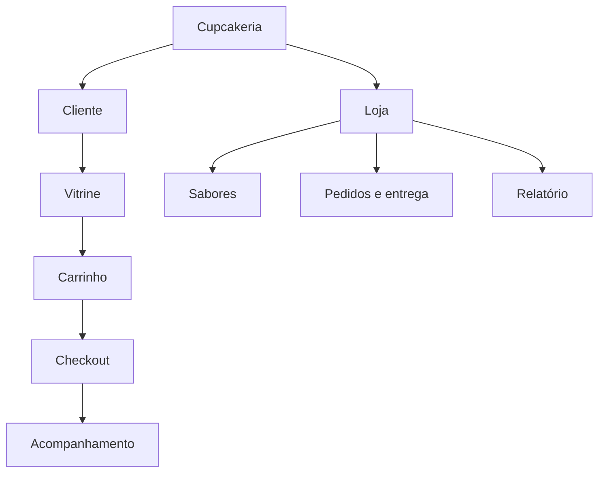

# 3. IHC: interface e usabilidade

## Telas
| Tela | Rota | Objetivo |
|---|---|---|
| Vitrine | `/` | Ver sabores, filtrar por categoria, adicionar ao carrinho |
| Carrinho | `/carrinho/` | Editar quantidades, remover, ver total |
| Checkout | `/checkout` | Dados, endereço e pagamento |
| Pedido | `/pedido/<n>` | Status e resumo |
| Acompanhar | `/acompanhar` | Consultar com número + e-mail |
| Login da loja | `/admin/login` | Acesso restrito |
| Pedidos / Sabores / Relatório | `/admin/...` | Gestão da loja |

## Wireframe da vitrine
```
+--------------------------------------------------+
| Cupcakeria      Vitrine  Acompanhar  Carrinho(2) |
+--------------------------------------------------+
| Cupcakes gourmet feitos hoje, entregues...       |
| (Todos) (Clássicos) (Sem açúcar) (Veganos)       |
| +---------+ +---------+ +---------+              |
| | [img]   | | [img]   | | [img]   |              |
| | Nome    | | Nome    | | Nome    |              |
| | R$ 9,00 | | R$ 11   | | R$ 10   |              |
| | [Adic.] | | [Adic.] | | [Adic.] |              |
| +---------+ +---------+ +---------+              |
+--------------------------------------------------+
```

## Mensagens de erro e feedback
| Situação | Mensagem |
|---|---|
| Carrinho vazio no checkout | Seu carrinho está vazio. Escolha um cupcake para continuar. |
| Sabor esgotado | Este sabor está esgotado no momento. |
| E-mail inválido | Informe um e-mail válido, como nome@exemplo.com. |
| CEP inválido | Informe o CEP no formato 00000-000. |
| Pagamento não escolhido | Escolha uma forma de pagamento: PIX ou cartão. |
| Pedido não encontrado | Não encontramos um pedido com esse número e e-mail. |
| Senha da loja errada | Senha incorreta. Tente novamente. |
| Sucesso | Pagamento aprovado! Seu pedido foi recebido. |

## Princípios do material aplicados
Clareza (rótulos diretos) · consistência (mesmos botões e cores) · simplicidade (fluxo de 3 passos) · controle do usuário (remover/editar itens) · feedback imediato (avisos após cada ação) · reversibilidade (carrinho editável) · estética (paleta ameixa, framboesa e pistache) · acessibilidade (foco visível, rótulos em todos os campos, contraste, responsivo).

## Mapa conceitual

