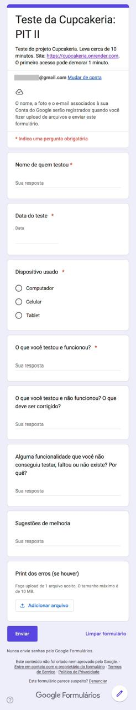

# 5. Testes com usuários e laudo de qualidade (Situação 3)

Este documento registra o formulário aplicado aos testadores, o resumo dos resultados e o laudo de qualidade da aplicação. O laudo completo, com as evidências em imagem, consta no documento de entrega, e as imagens estão em [`testes-e-laudo/evidencias/`](testes-e-laudo/evidencias).

## 5.1 Formulário aplicado

O formulário foi criado no Google Forms, com o título "Teste da Cupcakeria: PIT II", e enviado a cinco colegas de curso. A descrição informava o endereço do site, o tempo estimado de dez minutos e o aviso de que o primeiro acesso pode demorar cerca de um minuto, porque o serviço gratuito de hospedagem entra em repouso após um período de inatividade.

| Campo | Tipo de resposta | Obrigatório |
|---|---|---|
| Nome de quem testou | Resposta curta | Sim |
| Data do teste | Data | Sim |
| Dispositivo usado | Múltipla escolha: Computador, Celular ou Tablet | Sim |
| O que você testou e funcionou? | Parágrafo | Sim |
| O que você testou e não funcionou? O que deve ser corrigido? | Parágrafo | Não |
| Alguma funcionalidade que você não conseguiu testar, faltou ou não existe? Por quê? | Parágrafo | Não |
| Sugestões de melhoria | Parágrafo | Não |
| Print dos erros (se houver) | Envio de arquivo (um arquivo, até 10 MB) | Não |

### Orientações enviadas aos testadores

A mensagem de convite pediu que o site fosse testado sem instalar nada, em cerca de dez minutos, e incentivou os colegas a tentarem encontrar erros: "Podem tentar quebrar o site à vontade, o meu objetivo é encontrar erros! Se algo der errado, tirem print e anexem no formulário. Se tudo funcionar, me contem isso também."

### Roteiro de referência

O roteiro abaixo serviu de base para a elaboração dos testes, e não fazia parte do formulário:

1. Filtrar os cupcakes por categoria.
2. Adicionar dois sabores ao carrinho e alterar a quantidade.
3. Preencher os dados na área de checkout.
4. Finalizar o pedido com PIX ou com cartão.
5. Acompanhar o pedido pelo número e pelo e-mail.

## 5.2 Resultados dos testes com usuários

Os testes ocorreram em 02/11/2026. Para preservar a privacidade dos colegas, os testadores são identificados por número neste repositório, e a identificação nominal consta no documento de entrega.

| Testador | Dispositivo | Fluxos testados | Resultado |
|---|---|---|---|
| 1 | Celular | Vitrine, filtro por categoria e carrinho | Nenhum erro encontrado |
| 2 | Celular | Carrinho, alteração de quantidades, checkout com PIX e acompanhamento do pedido | Nenhum erro encontrado |
| 3 | Computador | Compra completa com PIX e tentativa de envio com endereço incompleto, que foi bloqueada com aviso na tela | Nenhum erro encontrado. Sugestão: exibir uma chave PIX |
| 4 | Celular | Catálogo, botões de quantidade e pagamento com cartão (simulado) | Nenhum erro encontrado. Sugestão: incluir campos para os dados do cartão |
| 5 | Computador | Filtro por categoria, carrinho, endereço no checkout e pagamento com PIX | Nenhum erro encontrado |

Funcionalidades não testadas pelos usuários: área da loja, por ser protegida por senha (testadores 1, 2 e 5); pagamento com cartão (testador 3); pagamento com PIX (testador 4).

### Testes complementares da autora (área da loja)

Na área da loja, a autora verificou que o sabor marcado como esgotado deixa de aparecer na vitrine, que um sabor recém-cadastrado passa a aparecer, que o relatório de vendas corresponde às quantidades vendidas, que os pedidos recebidos exibem as informações necessárias e que a alteração de status é refletida na tela de acompanhamento do cliente.

## 5.3 Laudo de qualidade

| # | Problema ou sugestão | Origem | Gravidade | Correção | Situação |
|---|---|---|---|---|---|
| 1 | Falha na inicialização do serviço no Render (`No module named 'psycopg'`), detectada antes de o site ficar disponível | Autora, durante a implantação | Alta | Driver `postgresql+psycopg2` definido em `app/config.py` | Corrigido |
| 2 | CEP exibido como link no celular | Autora, na análise das imagens dos testadores | Baixa | Instrução `format-detection` em `base.html` | Corrigido |
| 3 | Campos Número e Complemento desalinhados no celular | Autora, na análise das imagens dos testadores | Baixa | Ajuste de CSS para telas de até 480 px, que reserva a mesma altura para os rótulos da linha | Corrigido |
| 4 | Sugestão: exibir uma chave PIX | Testador 3 | Melhoria | Código fictício de demonstração, com botão para copiá-lo | Implementado |
| 5 | Sugestão: incluir campos para os dados do cartão | Testador 4 | Melhoria | Campos de número, nome, validade e CVV, com validação no servidor e sem armazenamento dos dados | Implementado |

**Verificação:** 77 testes automatizados (`python -m pytest -v`), todos aprovados: 55 da versão testada pelos usuários e 22 adicionados na melhoria do pagamento.

**Validação:** testes realizados por cinco usuários, no computador e no celular, e testes complementares da autora na área da loja.

**Limitações conhecidas:** pagamento e e-mail simulados, sem operadora de pagamento nem servidor de e-mail; ausência de login de cliente; história US15 (histórico de pedidos) não implementada; validação de endereço restrita ao formato do CEP, sem confirmar a existência.